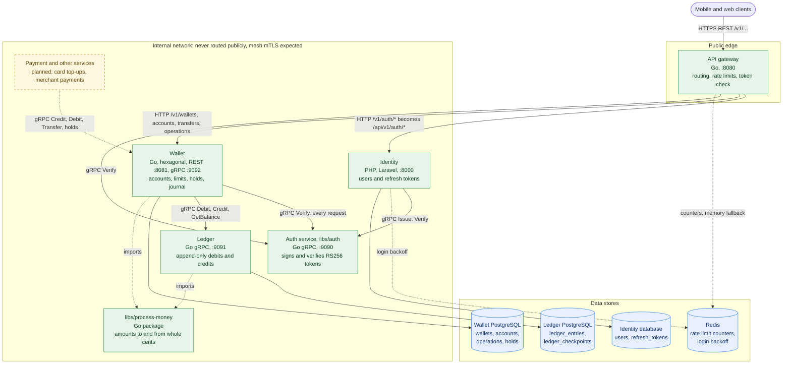
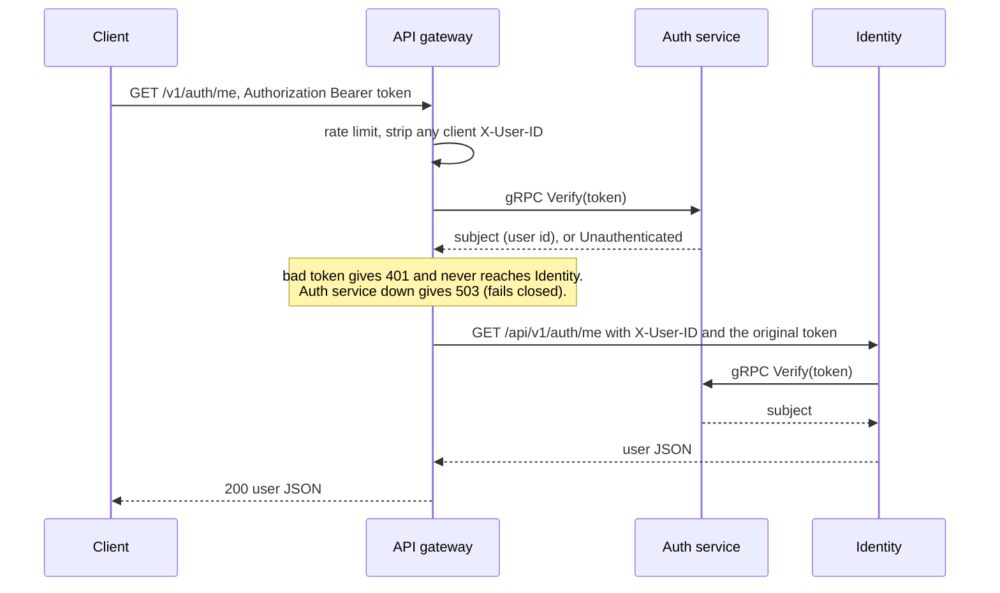
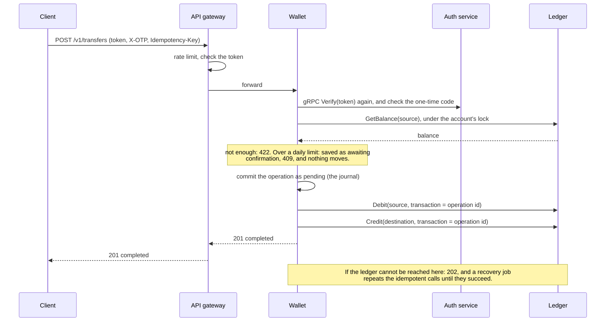

# E-Wallet

A micro-service e-wallet: peer-to-peer transfers, card top-ups, merchant payments and transaction
history, built as a mesh of small services with each service owning its own data.

**Status: early.** The sign-in path (gateway, Identity, token service), the **ledger** and the **wallet
service** (users' accounts, transfers, limits, holds, built on the ledger) are built and tested. Payment, the
fee engine and the rest are next. The full target design is in
[E-Wallet Micro-Service System Design.md](E-Wallet%20Micro-Service%20System%20Design.md).

- [Where things stand](#where-things-stand)
- [System architecture](#system-architecture)
- [Design decisions](#design-decisions)
- [Trade-off analysis](#trade-off-analysis)
- [How it was built and checked](#how-it-was-built-and-checked)
- [Repository layout](#repository-layout)
- [Getting started](#getting-started)
- [Roadmap](#roadmap)
- [Documentation](#documentation)

## Where things stand

| Component | What it does | Stack | Status |
| --- | --- | --- | --- |
| [API gateway](gateway) | The public entry point: routes requests, checks tokens, limits request rates. Configured by one YAML file. | Go | Built, tested |
| [Identity](services/identity) | Register, log in, refresh, log out, current user. Owns users and refresh tokens. | PHP, Laravel 13 | Built, tested |
| [Auth service](libs/auth) (`libs/auth`) | Holds the signing key; issues and verifies access tokens over internal gRPC. | Go | Built, tested |
| [Ledger](services/ledger) | An append-only record of debits and credits per account; balances from checkpoints; posted and read over internal gRPC. | Go, PostgreSQL | Built, tested |
| [Wallet](services/wallet) | One wallet per user with several accounts: deposits, withdrawals and transfers, daily limits with a two-step confirmation, holds, one-time codes. Moves money by calling the ledger, and finishes what a failure interrupts. REST for users, internal gRPC for other services. A hexagonal service. | Go, PostgreSQL | Built, tested |
| [Money package](libs/process-money) (`libs/process-money`) | The one place amounts are cast between decimals and whole cents; used by the ledger and the wallet. | Go | Built, tested |
| Payment, Fee Engine, KYC, Notification, Audit, Reporting | The rest of the design. | Go, Python, Node | Not started |
| Shared libs (events, observability, pagination); Terraform, Helm, Istio, compose, CI, Dockerfiles | Platform plumbing. | | Skeleton files only |

### What works today

- A user can register, log in, call a protected endpoint with a short-lived token, refresh it (the old refresh token stops working) and log out, all through the gateway.
- Other services can post debits and credits to the ledger, and read balances, entries and checkpoints. A debit larger than the balance is refused, concurrent debits can never overdraw an account, and history can only be added to, never changed.
- A signed-in user has a wallet with several accounts. With a one-time code and an idempotency key they can deposit (simulated, off unless enabled), withdraw, and transfer between their own accounts or to another user, set a wallet limit and per-account limits (which must add up to no more than the wallet's), freeze, unfreeze and close accounts, and see balances. A spend over a limit is saved, not refused, and needs a second, explicit confirmation. The Payment service will be able to credit, debit, transfer and hold money over gRPC.
- If the ledger is unreachable part-way through, the operation is kept and finished later; the wallet never loses money between itself and the ledger (see [How it was built and checked](#how-it-was-built-and-checked)).

**Not yet verified end to end:** Identity's call to the Go auth service is tested against a mock; a real
PHP-to-Go call needs the PHP `grpc` extension, which the development machine did not have. Everything
else was exercised against real PostgreSQL, Redis and gRPC connections, including a run of the real auth
service, ledger, wallet and gateway together (see [How it was built and checked](#how-it-was-built-and-checked)).

## System architecture



Green is built, dashed amber is planned, blue is storage. Solid arrows are the request path. Dotted
arrows are supporting links (counters and backoff in Redis, the shared package that two services import) or
links that do not exist yet: nothing calls the wallet's gRPC API until the Payment service is built. Only
the wallet calls the ledger. The gateway keeps limiting without Redis; Identity's login does not.

| Component | Default address | Reachable from |
| --- | --- | --- |
| API gateway | `:8080` HTTP | Clients |
| Identity | `127.0.0.1:8000` HTTP | The gateway only |
| Auth service | `127.0.0.1:9090` gRPC | Internal services only |
| Ledger | `127.0.0.1:9091` gRPC | Internal services only |
| Wallet | `127.0.0.1:8081` HTTP, `127.0.0.1:9092` gRPC | HTTP: the gateway only. gRPC: internal services only |

### An authenticated request



### A ledger post

`Debit` or `Credit` over gRPC runs in one database transaction. It takes a lock on the account, returns
the original entry if this transaction was already posted (so retries are safe), checks the balance (a
debit above it is refused, and so is any debit on a zero balance), appends one entry, and returns the
new balance. The balance is the account's latest checkpoint plus the entries after it. See the
[ledger documentation](docs/ledger-service.md).

### A transfer



## Design decisions

| Area | Decision | Why |
| --- | --- | --- |
| Platform | Polyglot micro-services: Go for the latency- and money-sensitive parts (gateway, auth, ledger), Laravel for Identity | Go's predictable latency suits the hot paths; Identity is CRUD-heavy and security-sensitive, which Laravel covers with little code |
| Platform | Each service owns its data; references across services are plain ids (UUIDs), never joins | Services deploy and fail independently. The ledger knows account ids only; accounts belong to the wallet service |
| Platform | gRPC between internal services, with the `.proto` file as the single source of truth and generated code committed | Typed contracts that other services (and languages) import instead of re-describing |
| Auth | Tokens are RS256 JWTs signed by one dedicated Go service. Access tokens last 15 minutes; refresh tokens are opaque, stored only as hashes, rotated on every use and revocable | Only one process holds the key. A leaked access token is short-lived and a leaked refresh token works once |
| Auth | Services verify tokens by asking the auth service, not by holding the public key | One implementation of the rules and nothing to distribute or rotate |
| Edge | One public entry point, a Go reverse proxy configured by YAML. It checks tokens, sets `X-User-ID`, and removes any client-supplied identity headers (including `X_User_ID` lookalikes) | Upstreams can trust `X-User-ID` only because nothing else can set it. A YAML file is easy to review and the config is validated at startup |
| Edge | Rate limits are counted in Redis; if Redis is down the gateway falls back to an in-memory limiter and switches back when Redis returns | Exact shared limits normally, and the API keeps serving during an outage |
| Security | Fail closed: if a token cannot be checked, the request is refused (gateway 503, Identity 500) | An outage must never become an open door |
| Security | Internal services carry no application-level secret; callers are meant to be restricted by network position and mesh mTLS (the mesh itself is not configured yet) | Keeps services simple and puts the identity of callers where the platform can enforce it |
| Security | Where a setting is a secret, give a file path instead of the value: the signing key, the ledger's database password, the gateway's Redis password. Identity still reads its own secrets from `.env` | Matches the design's Vault-at-boot model: a mounted file, not a value in the environment or the repo |
| Ledger | Append-only, enforced by the database (triggers refuse `UPDATE`, `DELETE`, `TRUNCATE`), plus check and unique constraints | A bug or a stray query cannot rewrite history. Corrections are new entries |
| Ledger | Amounts are floats at the API and **whole cents in integers** underneath (x 100 in, / 100 out), never silently rounded | Sums are exact, and callers get floats without extra effort |
| Ledger | Balance = latest checkpoint + entries after it. Nothing stores a running balance, so there is nothing to update | Keeps the data purely append-only and the balance derivable and auditable |
| Ledger | A debit is refused if it exceeds the balance (every debit on a zero balance included), decided under a per-account lock in the same transaction as the insert | Two concurrent debits can never both spend the same money, even across several ledger servers |
| Ledger | Checkpoints every month, quarter, year and five years. Each period type is its own chain, built only from its previous checkpoint and the entries since | Four independent calculations of the same balances: a mistake in one cannot hide in another |
| Ledger | Retries are made safe by the entry's identity: account + `transaction_id` + direction. The two legs of a transfer share one `transaction_id` | Idempotency is atomic with the insert and needs no separate table |
| Wallet | A **hexagonal** core (domain and use cases) with no database, HTTP or gRPC imports, and adapters for REST, gRPC, PostgreSQL, the ledger, the auth service, one-time codes and funding. An architecture test fails the build if an import points outward | The rules can be tested fast against fakes, the ledger and the database are swappable behind ports, and the layering cannot erode unnoticed |
| Wallet | One wallet per user, several accounts per wallet, each account with its own ledger; no balance is stored in the wallet | The ledger is the only record of how much an account holds, so the two can never disagree |
| Wallet | Money moves as **journalled operations**: the operation is committed first, every ledger call carries its id as the transaction id, and a refund is a credit with the debit's own id. A recovery job finishes what stopped | A wallet and a ledger with separate databases cannot share a transaction; idempotent calls plus a journal give the same safety without one |
| Wallet | Daily limits are soft: the user sets a wallet limit and account limits (which must sum to at most the wallet's), and going over is saved and needs a second, explicit confirmation with its own one-time code | Matches "no system ceiling, the user defines it" while making an over-limit spend a deliberate act |
| Wallet | Every sensitive action needs a one-time code; until `libs/auth` issues real ones it is a configured static value | The flow exists and is tested now, and real codes replace one adapter later |
| Wallet | Simulated funding is **off unless enabled**, and a second gateway refuses everything when it is off | A deposit creates ledger money with nothing behind it, so it must never be on by accident |
| Wallet | The wallet verifies the token itself and ignores the gateway's `X-User-ID`; another user's data is `404` | One fewer thing to trust, and ids cannot be probed |
| Platform | Ids are UUIDs everywhere, including users (Identity was switched from integer ids) and enums are `smallint` columns with explicit codes and `CHECK`s, mirrored by Go enums | Ids cannot be guessed or confused across services; enum codes cannot shift when a constant is reordered |
| Platform | Money casting lives in one shared Go package, imported by the ledger and the wallet | What counts as a valid amount is written, and tested, once |
| Quality | Test against real dependencies (PostgreSQL, gRPC connections, Redis behaviour), then break the code on purpose to prove the tests notice | Mocks cannot prove a database trigger or a lock works |

## Trade-off analysis

Every row is a deliberate choice with a price. "Revisit when" says what would change the decision.

| Decision | What we gain | What it costs, and when to revisit |
| --- | --- | --- |
| Go gateway with YAML config instead of Envoy | One language, a small codebase, fully tested behaviour | No TLS termination, retries, circuit breaking, hot reload or metrics yet, and we own the proxy's security. Revisit when traffic management needs grow (canaries, edge mTLS); the route model maps onto Envoy or Istio |
| Verify tokens by RPC to the auth service | The key stays in one process; a single implementation of the rules | A network hop per protected request, a runtime dependency, and Identity verifies again (two calls per request). Revisit if latency matters: cache verdicts briefly or verify locally at the edge |
| Stateless access tokens | Cheap to verify and scale | Cannot be revoked before they expire (15 minutes). Revisit if instant revocation is needed: add a deny list the auth service consults |
| Refresh token lifetime defaults to 15 minutes (configurable) | A tight idle timeout | Users sign in again often unless it is raised; the design suggests 30 days. A product decision |
| Fail closed | No unchecked access, ever | An auth-service outage rejects protected requests, and a Redis outage rejects logins at Identity. Revisit if the availability target needs degraded modes |
| Redis rate limits with an in-memory fallback, fixed windows | Shared, exact limits normally; keeps serving when Redis is down | During an outage limits are per gateway instance (looser), and fixed windows allow up to twice the limit at a window boundary. Revisit for sliding windows or per-user limits |
| Internal gRPC with no per-call credentials | Simple, no secret management between services | Any internal caller can mint tokens or post to the ledger. Revisit with a mesh `AuthorizationPolicy` per method |
| Hand-written RS256 (Go standard library) | No dependency, a small auditable core | Security-sensitive code we maintain ourselves. Revisit if we need key rotation or JWKS; adopt a vetted library then |
| Integer cents, floats at the edge | Exact arithmetic, simple storage and tests | Only two-decimal currencies; more decimals are rejected; no currency column. Revisit for multi-currency: store currency and a minor-unit exponent |
| Computed balance (checkpoint + later entries) | Append-only purity; balance is derived, never edited | Read cost grows with entries since the last checkpoint; checkpoints are trusted, not re-verified at runtime; the checkpoint job scans the entries table. Revisit for very busy accounts: checkpoint more often and add reconciliation |
| Per-account advisory lock in one transaction | Simple and provably no overdraft, across replicas | Writes to one account are serialized. Revisit if a single account becomes hot: batching or optimistic concurrency |
| Append-only enforced by triggers | Protects against bugs and casual SQL | A superuser can drop the triggers. Revisit with restricted roles or write-once storage for regulators |
| Transfers are two ledger calls (no atomic transfer RPC) | A small ledger that fits the design's saga | Callers must retry or compensate after a partial failure. The wallet now does exactly that. Revisit if sagas prove fragile |
| Hexagonal wallet (ports and adapters) | Fast core tests, swappable one-time codes and funding, an enforced dependency rule | More types and interfaces than the ledger's three layers, and a different shape from the other Go services. Revisit if it feels heavy for a service this size |
| A journal plus idempotent ledger calls instead of a distributed transaction | No coordinator, and a crash at any point is recoverable | An operation can be in flight for a while (`202`), and recovery must be running. Revisit with an event-driven saga if Kafka arrives |
| The debit leg holds the account's row lock across the ledger call | `available` is exact: money is never counted twice between "debited" and "recorded" | A slow ledger delays other operations on the same account up to its timeout (3 s). Revisit if one account becomes hot |
| An operation is failed after five working days **only where that cannot lose money** | The user's rule, without a way to lose money on a guess | While the ledger is down a stuck debit is kept past its deadline (and refunded and failed when the ledger answers), and a transfer whose money has left the source is never failed on time. Revisit with a way to ask the ledger "did this land?" |
| Soft limits with a two-step confirmation | The user is in control; going over is deliberate | A user (or an attacker holding the static code) can confirm past any limit. The limit is a speed bump, not a wall. Revisit with a hard ceiling per KYC tier |
| A static one-time code | The whole flow is built and tested before real codes exist | It is a shared secret, not a second factor; only the gateway's rate limit slows guessing. Replace with codes from `libs/auth` |
| Simulated funding | Deposits and withdrawals work end to end today | They create and destroy money with nothing real behind them; off by default. Replace with the Payment service's rails |
| The wallet re-verifies every token with the auth service | The wallet does not trust a header the gateway sets | A second gRPC call per request on top of the gateway's. Revisit with a short verdict cache |
| Integer-id to UUID change by editing Identity's original migrations | A clean schema | Existing development databases need `migrate:fresh`. Nothing is deployed, so nothing real is lost |
| Ledger writes over gRPC, not Kafka | An immediate answer (new balance or refusal); easy to test | Tighter coupling than the design's async path, and no event replay. Revisit if the transfer latency target needs asynchronous writes |
| Identity on Laravel with a custom token guard instead of Passport | Fewer dependencies; tokens come from the shared Go service | We maintain the guard and refresh logic ourselves |
| Real-dependency tests | They catch real defects | The ledger tests need a PostgreSQL (Docker is easiest) and run slower |

### Risks we are carrying

1. **The auth service is on the critical path** of every protected request. Run it with replicas, and measure before adding caching.
2. **Checkpoints are trusted.** A wrong checkpoint would be believed until reconciliation exists. Nothing can edit one, and they are built by independent chains, but nothing yet re-sums history to compare.
3. **Any internal caller can post to the ledger** until a mesh policy limits it to the wallet and payment services.
4. **The PHP-to-Go gRPC call has not been run end to end** (see [Where things stand](#where-things-stand)).
5. **Behind a load balancer**, rate limits and login backoff need the real client address: set `server.client_ip_header` on the gateway and configure trusted proxies on Identity.
6. **The one-time code is not a second factor.** Anyone who knows the static value is treated as the user for deposits, transfers and limits. Do not expose the wallet beyond development until real codes exist.
7. **Simulated funding creates money.** Keep `WALLET_FUNDING_MODE` at `disabled` anywhere real.
8. **Any internal caller of the wallet's gRPC port can move any account's money**, as with the ledger, until a mesh policy limits it to the Payment service.
9. **Nothing compares the wallet's journal with the ledger at runtime.** They agree in every test and end-to-end run, but a reconciliation job is not built.

## How it was built and checked

- **Real dependencies, not mocks.** The ledger's and the wallet's tests run against a real PostgreSQL (each test in its own schema), the gateway's against real gRPC connections and an in-process Redis, Identity's against real Redis.
- **Properties, not just examples.** Every whole-cent amount survives the trip through a float; concurrent debits never overdraw; a long random ledger always equals a plain sum of its entries after every checkpoint run; and for the wallet, **random failures** (the ledger unreachable, answers lost after the ledger acted, the database refusing a status update, time jumping past deadlines) fired at 40 seeds of concurrent transfers never create or lose a cent, and every operation ends in a final state.
- **One contract suite per port, run against the fake and the real thing.** The wallet's store (in-memory and PostgreSQL) and its ledger port (an in-memory fake, the gRPC client over a fake server, and the real ledger) pass the same tests, so the fakes the fast tests rely on cannot drift.
- **The architecture is a test.** The wallet's hexagonal rule (imports point inward only) fails the build when broken, and the test is itself checked against deliberate violations.
- **Mutation checks.** Across the components the code was deliberately broken in dozens of ways (skip the balance check, drop a trigger, forget to strip a header, and more) and the tests had to fail every time. Tests that could not tell a defect from correct code were strengthened.
- **Bugs caught before they shipped.** Writing the long random-history test exposed a checkpoint calculation that could lose an entry if the clock ever stepped backwards. For the wallet, a concurrency test showed that between the ledger applying a debit and the wallet recording it, the money was counted twice and a valid request was refused, so the debit now runs under the account's row lock. Another test showed confirming a cancelled operation returned success; another that a stale expiry was counted as work done.
- **Mutation checks on the wallet.** 60 deliberate breakages (skip a lock, drop the idempotency check, let a frozen account move money, never refund, import a web package into the core, and more): 54 were caught at once. The 6 survivors were examined rather than waved through: five pointed at behaviour no test had pinned down (for example, nothing proved that the wallet lock stops two accounts of one wallet together exceeding the wallet limit). Each now has a test that kills its mutant, and in one case the examination showed a lock the debit did not need, which was removed and the lock it does need given a test. The sixth (`ORDER BY id` on a lock query) is an equivalent change PostgreSQL cannot tell apart.
- **End-to-end runs.** Real binaries were started and driven over the network: the gateway in front of real services, two ledger servers sharing one database (migrations, checkpoints and the account lock are safe across replicas), and then the **real auth service, ledger, wallet and gateway together over real PostgreSQL**: 83 checks covering authentication edge cases, deposits and the one-time code, own and cross-user transfers, the limit sum rule, the two-step over-limit confirmation, freeze and close, idempotent retries, holds over gRPC, **stopping the ledger mid-operation and watching recovery finish it exactly once**, a stuck operation refunded and failed on timeout, funding switched off, and finally that every ledger entry belongs to exactly one wallet operation and money is conserved.

The mutation and end-to-end scripts were throwaway and are not kept in the repository; turning them into a CI job is part of the [roadmap](#roadmap).

## Repository layout

```text
e-wallet/
  gateway/                  API gateway (Go): YAML-configured reverse proxy
  libs/
    auth/                   Token service (Go gRPC): issues and verifies RS256 tokens
    process-money/          Shared Go package: amounts to and from whole cents
    events/ observability/ pagination/    reserved, empty
  services/
    identity/               Users, refresh tokens, auth endpoints (Laravel)
    ledger/                 Append-only debits and credits (Go gRPC, PostgreSQL)
    wallet/                 Wallets, accounts, limits, holds, the operation journal (Go, hexagonal, PostgreSQL)
    payment/ fee-engine/ kyc/ notification/ audit/ reporting/    not started
  docs/                     Per-component documentation
  infra/                    Terraform, Helm, Istio and Kubernetes manifests (skeletons)
  E-Wallet Micro-Service System Design.md    The target design
```

## Getting started

You need Go 1.26, PHP 8.3 or newer (with the `redis` and `grpc` extensions), Composer, Redis,
PostgreSQL (or Docker), and `openssl`. The step-by-step walk-through, with `curl` examples for the whole
sign-in flow and for starting the ledger, is in [docs/README.md](docs/README.md#run-everything-locally).

Run a component's tests:

```bash
cd libs/auth && make test                          # Go
cd gateway && go test -race ./...                  # Go
cd services/identity && php artisan test --compact # needs Redis
cd services/ledger && make test-db-up && make test # needs Docker or a PostgreSQL
cd libs/process-money && make test                 # Go
cd services/wallet && make test-db-up && make test # needs Docker or a PostgreSQL
```

## Roadmap

1. **Payment service**: top-ups and merchant payments over the wallet's gRPC API (credit, debit, transfer, holds), replacing the simulated funding gateway with real card and bank rails.
2. **Real one-time codes** in `libs/auth`, replacing the wallet's static code, and a second factor that is one.
3. **Mesh policy** limiting who may call the auth service's `Issue`, the ledger's `Debit` and `Credit`, and the wallet's gRPC API.
4. **Reconciliation:** re-sum the ledger's history against its checkpoints, and compare the wallet's journal with the ledger at runtime. An atomic transfer call, or a way to ask the ledger "did this land?", if sagas prove fragile.
5. **Events:** the wallet's `wallet.events` and the ledger's `ledger.entries` on Kafka, as in the design.
6. **Real end-to-end test** of Identity against the auth service with the PHP `grpc` extension in CI, and the full-chain and mutation runs as CI jobs.
7. **Platform plumbing:** Dockerfiles, Helm charts, compose and CI (including running the database-backed tests and the mutation checks), TLS at the edge, metrics and tracing.
8. **The remaining services:** fee engine, KYC and AML (velocity limits, KYC-tier ceilings), notifications, audit and reporting.

## Documentation

| Page | Covers |
| --- | --- |
| [docs/README.md](docs/README.md) | How the components fit together, request flows, running everything locally, differences from the design |
| [docs/api-gateway.md](docs/api-gateway.md) | The gateway: pipeline, every YAML setting, rate limiting and failover |
| [docs/identity-service.md](docs/identity-service.md) | The auth endpoints, token model, login backoff |
| [docs/libs-auth.md](docs/libs-auth.md) | The token service: gRPC API, token format, configuration |
| [docs/ledger-service.md](docs/ledger-service.md) | The ledger: API, amounts, balances and checkpoints, data model, concurrency |
| [docs/wallet-service.md](docs/wallet-service.md) | The wallet: hexagonal architecture, REST and gRPC APIs, limits and confirmation, how money reaches the ledger and what happens when it fails, data model, configuration |
| [docs/process-money.md](docs/process-money.md) | The shared money package: what counts as a valid amount, and why floats stop at the edge |
| [System design](E-Wallet%20Micro-Service%20System%20Design.md) | The target architecture all of this builds towards |

## License

GNU General Public License v3.0. See [LICENSE](LICENSE).
