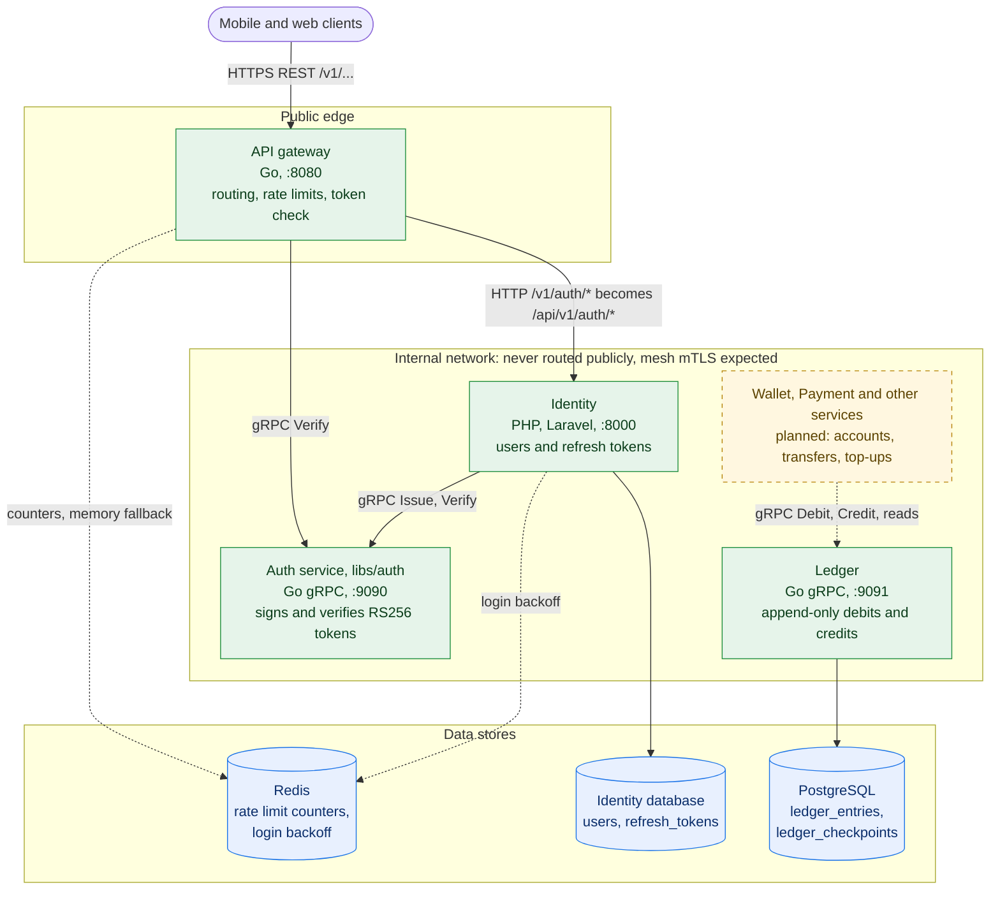
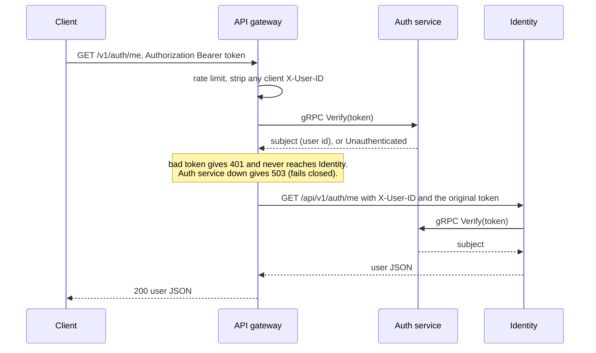

# E-Wallet

A micro-service e-wallet: peer-to-peer transfers, card top-ups, merchant payments and transaction
history, built as a mesh of small services with each service owning its own data.

**Status: early.** The sign-in path (gateway, Identity, token service) and the **ledger** are built and
tested. The services that move money on top of them (wallet, payment) are next. The full target design
is in [E-Wallet Micro-Service System Design.md](E-Wallet%20Micro-Service%20System%20Design.md).

- [Where things stand](#where-things-stand)
- [System architecture](#system-architecture)
- [Design decisions](#design-decisions)
- [Trade-off analysis](#trade-off-analysis)
- [How it was built and checked](#how-it-was-built-and-checked)
- [Repository layout](#repository-layout)
- [Getting started](#getting-started)
- [Roadmap](#roadmap)
- [Documentation](#documentation)

## Where things stand

| Component | What it does | Stack | Status |
| --- | --- | --- | --- |
| [API gateway](gateway) | The public entry point: routes requests, checks tokens, limits request rates. Configured by one YAML file. | Go | Built, tested |
| [Identity](services/identity) | Register, log in, refresh, log out, current user. Owns users and refresh tokens. | PHP, Laravel 13 | Built, tested |
| [Auth service](libs/auth) (`libs/auth`) | Holds the signing key; issues and verifies access tokens over internal gRPC. | Go | Built, tested |
| [Ledger](services/ledger) | An append-only record of debits and credits per account; balances from checkpoints; posted and read over internal gRPC. | Go, PostgreSQL | Built, tested |
| Wallet (accounts), Payment, Fee Engine, KYC, Notification, Audit, Reporting | The rest of the design. | Go, Python, Node | Not started |
| Shared libs (events, observability, pagination); Terraform, Helm, Istio, compose, CI, Dockerfiles | Platform plumbing. | | Skeleton files only |

### What works today

- A user can register, log in, call a protected endpoint with a short-lived token, refresh it (the old refresh token stops working) and log out, all through the gateway.
- Other services can post debits and credits to the ledger, and read balances, entries and checkpoints. A debit larger than the balance is refused, concurrent debits can never overdraw an account, and history can only be added to, never changed.

**Not yet verified end to end:** Identity's call to the Go auth service is tested against a mock; a real
PHP-to-Go call needs the PHP `grpc` extension, which the development machine did not have. Everything
else was exercised against real PostgreSQL, Redis and gRPC connections (see
[How it was built and checked](#how-it-was-built-and-checked)).

## System architecture



Green is built, dashed amber is planned, blue is storage. Solid arrows are the request path. Dotted
arrows are supporting links (counters and backoff in Redis) or links that do not exist yet: nothing calls
the ledger until the wallet and payment services are built. The gateway keeps limiting without Redis;
Identity's login does not.

| Component | Default address | Reachable from |
| --- | --- | --- |
| API gateway | `:8080` HTTP | Clients |
| Identity | `127.0.0.1:8000` HTTP | The gateway only |
| Auth service | `127.0.0.1:9090` gRPC | Internal services only |
| Ledger | `127.0.0.1:9091` gRPC | Internal services only |

### An authenticated request



### A ledger post

`Debit` or `Credit` over gRPC runs in one database transaction. It takes a lock on the account, returns
the original entry if this transaction was already posted (so retries are safe), checks the balance (a
debit above it is refused, and so is any debit on a zero balance), appends one entry, and returns the
new balance. The balance is the account's latest checkpoint plus the entries after it. See the
[ledger documentation](docs/ledger-service.md).

## Design decisions

| Area | Decision | Why |
| --- | --- | --- |
| Platform | Polyglot micro-services: Go for the latency- and money-sensitive parts (gateway, auth, ledger), Laravel for Identity | Go's predictable latency suits the hot paths; Identity is CRUD-heavy and security-sensitive, which Laravel covers with little code |
| Platform | Each service owns its data; references across services are plain ids (UUIDs), never joins | Services deploy and fail independently. The ledger knows account ids only; accounts belong to the wallet service |
| Platform | gRPC between internal services, with the `.proto` file as the single source of truth and generated code committed | Typed contracts that other services (and languages) import instead of re-describing |
| Auth | Tokens are RS256 JWTs signed by one dedicated Go service. Access tokens last 15 minutes; refresh tokens are opaque, stored only as hashes, rotated on every use and revocable | Only one process holds the key. A leaked access token is short-lived and a leaked refresh token works once |
| Auth | Services verify tokens by asking the auth service, not by holding the public key | One implementation of the rules and nothing to distribute or rotate |
| Edge | One public entry point, a Go reverse proxy configured by YAML. It checks tokens, sets `X-User-ID`, and removes any client-supplied identity headers (including `X_User_ID` lookalikes) | Upstreams can trust `X-User-ID` only because nothing else can set it. A YAML file is easy to review and the config is validated at startup |
| Edge | Rate limits are counted in Redis; if Redis is down the gateway falls back to an in-memory limiter and switches back when Redis returns | Exact shared limits normally, and the API keeps serving during an outage |
| Security | Fail closed: if a token cannot be checked, the request is refused (gateway 503, Identity 500) | An outage must never become an open door |
| Security | Internal services carry no application-level secret; callers are meant to be restricted by network position and mesh mTLS (the mesh itself is not configured yet) | Keeps services simple and puts the identity of callers where the platform can enforce it |
| Security | Where a setting is a secret, give a file path instead of the value: the signing key, the ledger's database password, the gateway's Redis password. Identity still reads its own secrets from `.env` | Matches the design's Vault-at-boot model: a mounted file, not a value in the environment or the repo |
| Ledger | Append-only, enforced by the database (triggers refuse `UPDATE`, `DELETE`, `TRUNCATE`), plus check and unique constraints | A bug or a stray query cannot rewrite history. Corrections are new entries |
| Ledger | Amounts are floats at the API and **whole cents in integers** underneath (x 100 in, / 100 out), never silently rounded | Sums are exact, and callers get floats without extra effort |
| Ledger | Balance = latest checkpoint + entries after it. Nothing stores a running balance, so there is nothing to update | Keeps the data purely append-only and the balance derivable and auditable |
| Ledger | A debit is refused if it exceeds the balance (every debit on a zero balance included), decided under a per-account lock in the same transaction as the insert | Two concurrent debits can never both spend the same money, even across several ledger servers |
| Ledger | Checkpoints every month, quarter, year and five years. Each period type is its own chain, built only from its previous checkpoint and the entries since | Four independent calculations of the same balances: a mistake in one cannot hide in another |
| Ledger | Retries are made safe by the entry's identity: account + `transaction_id` + direction. The two legs of a transfer share one `transaction_id` | Idempotency is atomic with the insert and needs no separate table |
| Quality | Test against real dependencies (PostgreSQL, gRPC connections, Redis behaviour), then break the code on purpose to prove the tests notice | Mocks cannot prove a database trigger or a lock works |

## Trade-off analysis

Every row is a deliberate choice with a price. "Revisit when" says what would change the decision.

| Decision | What we gain | What it costs, and when to revisit |
| --- | --- | --- |
| Go gateway with YAML config instead of Envoy | One language, a small codebase, fully tested behaviour | No TLS termination, retries, circuit breaking, hot reload or metrics yet, and we own the proxy's security. Revisit when traffic management needs grow (canaries, edge mTLS); the route model maps onto Envoy or Istio |
| Verify tokens by RPC to the auth service | The key stays in one process; a single implementation of the rules | A network hop per protected request, a runtime dependency, and Identity verifies again (two calls per request). Revisit if latency matters: cache verdicts briefly or verify locally at the edge |
| Stateless access tokens | Cheap to verify and scale | Cannot be revoked before they expire (15 minutes). Revisit if instant revocation is needed: add a deny list the auth service consults |
| Refresh token lifetime defaults to 15 minutes (configurable) | A tight idle timeout | Users sign in again often unless it is raised; the design suggests 30 days. A product decision |
| Fail closed | No unchecked access, ever | An auth-service outage rejects protected requests, and a Redis outage rejects logins at Identity. Revisit if the availability target needs degraded modes |
| Redis rate limits with an in-memory fallback, fixed windows | Shared, exact limits normally; keeps serving when Redis is down | During an outage limits are per gateway instance (looser), and fixed windows allow up to twice the limit at a window boundary. Revisit for sliding windows or per-user limits |
| Internal gRPC with no per-call credentials | Simple, no secret management between services | Any internal caller can mint tokens or post to the ledger. Revisit with a mesh `AuthorizationPolicy` per method |
| Hand-written RS256 (Go standard library) | No dependency, a small auditable core | Security-sensitive code we maintain ourselves. Revisit if we need key rotation or JWKS; adopt a vetted library then |
| Integer cents, floats at the edge | Exact arithmetic, simple storage and tests | Only two-decimal currencies; more decimals are rejected; no currency column. Revisit for multi-currency: store currency and a minor-unit exponent |
| Computed balance (checkpoint + later entries) | Append-only purity; balance is derived, never edited | Read cost grows with entries since the last checkpoint; checkpoints are trusted, not re-verified at runtime; the checkpoint job scans the entries table. Revisit for very busy accounts: checkpoint more often and add reconciliation |
| Per-account advisory lock in one transaction | Simple and provably no overdraft, across replicas | Writes to one account are serialized. Revisit if a single account becomes hot: batching or optimistic concurrency |
| Append-only enforced by triggers | Protects against bugs and casual SQL | A superuser can drop the triggers. Revisit with restricted roles or write-once storage for regulators |
| Transfers are two ledger calls (no atomic transfer RPC) | A small ledger that fits the design's saga | Callers must retry or compensate after a partial failure. Revisit if sagas prove fragile |
| Ledger writes over gRPC, not Kafka | An immediate answer (new balance or refusal); easy to test | Tighter coupling than the design's async path, and no event replay. Revisit if the transfer latency target needs asynchronous writes |
| Identity on Laravel with a custom token guard instead of Passport | Fewer dependencies; tokens come from the shared Go service | We maintain the guard and refresh logic ourselves |
| Real-dependency tests | They catch real defects | The ledger tests need a PostgreSQL (Docker is easiest) and run slower |

### Risks we are carrying

1. **The auth service is on the critical path** of every protected request. Run it with replicas, and measure before adding caching.
2. **Checkpoints are trusted.** A wrong checkpoint would be believed until reconciliation exists. Nothing can edit one, and they are built by independent chains, but nothing yet re-sums history to compare.
3. **Any internal caller can post to the ledger** until a mesh policy limits it to the wallet and payment services.
4. **The PHP-to-Go gRPC call has not been run end to end** (see [Where things stand](#where-things-stand)).
5. **Behind a load balancer**, rate limits and login backoff need the real client address: set `server.client_ip_header` on the gateway and configure trusted proxies on Identity.

## How it was built and checked

- **Real dependencies, not mocks.** The ledger's tests run against a real PostgreSQL (each test in its own schema), the gateway's against real gRPC connections and an in-process Redis, Identity's against real Redis.
- **Properties, not just examples.** Every whole-cent amount survives the trip through a float; concurrent debits never overdraw; a long random ledger always equals a plain sum of its entries after every checkpoint run.
- **Mutation checks.** Across the components the code was deliberately broken in dozens of ways (skip the balance check, drop a trigger, forget to strip a header, and more) and the tests had to fail every time. Tests that could not tell a defect from correct code were strengthened.
- **A bug caught before it shipped.** Writing the long random-history test exposed a checkpoint calculation that could lose an entry if the clock ever stepped backwards. It was fixed and has its own test.
- **End-to-end runs.** Real binaries were started and driven over the network: the gateway in front of real services, and two ledger servers sharing one database, which showed that migrations, checkpoints and the account lock are safe across replicas.

The mutation and end-to-end scripts were throwaway and are not kept in the repository; turning them into a CI job is part of the [roadmap](#roadmap).

## Repository layout

```text
e-wallet/
  gateway/                  API gateway (Go): YAML-configured reverse proxy
  libs/
    auth/                   Token service (Go gRPC): issues and verifies RS256 tokens
    events/ observability/ pagination/    reserved, empty
  services/
    identity/               Users, refresh tokens, auth endpoints (Laravel)
    ledger/                 Append-only debits and credits (Go gRPC, PostgreSQL)
    wallet/ payment/ fee-engine/ kyc/ notification/ audit/ reporting/    not started
  docs/                     Per-component documentation
  infra/                    Terraform, Helm, Istio and Kubernetes manifests (skeletons)
  E-Wallet Micro-Service System Design.md    The target design
```

## Getting started

You need Go 1.26, PHP 8.3 or newer (with the `redis` and `grpc` extensions), Composer, Redis,
PostgreSQL (or Docker), and `openssl`. The step-by-step walk-through, with `curl` examples for the whole
sign-in flow and for starting the ledger, is in [docs/README.md](docs/README.md#run-everything-locally).

Run a component's tests:

```bash
cd libs/auth && make test                          # Go
cd gateway && go test -race ./...                  # Go
cd services/identity && php artisan test --compact # needs Redis
cd services/ledger && make test-db-up && make test # needs Docker or a PostgreSQL
```

## Roadmap

1. **Wallet service** (the e-wallet service): owns users' accounts and calls the ledger to move money.
2. **Payment service**: top-ups, transfers (a debit and a credit sharing one `transaction_id`), merchant payments.
3. **Mesh policy** limiting who may call the auth service's `Issue` and the ledger's `Debit` and `Credit`.
4. **Ledger reconciliation** that re-sums history against checkpoints, and an atomic transfer call if sagas prove fragile.
5. **Real end-to-end test** of Identity against the auth service with the PHP `grpc` extension in CI.
6. **Platform plumbing:** Dockerfiles, Helm charts, compose and CI (including running the database-backed tests and the mutation checks), TLS at the edge, metrics and tracing.
7. **The remaining services:** fee engine, KYC and AML, notifications, audit and reporting.

## Documentation

| Page | Covers |
| --- | --- |
| [docs/README.md](docs/README.md) | How the components fit together, request flows, running everything locally, differences from the design |
| [docs/api-gateway.md](docs/api-gateway.md) | The gateway: pipeline, every YAML setting, rate limiting and failover |
| [docs/identity-service.md](docs/identity-service.md) | The auth endpoints, token model, login backoff |
| [docs/libs-auth.md](docs/libs-auth.md) | The token service: gRPC API, token format, configuration |
| [docs/ledger-service.md](docs/ledger-service.md) | The ledger: API, amounts, balances and checkpoints, data model, concurrency |
| [System design](E-Wallet%20Micro-Service%20System%20Design.md) | The target architecture all of this builds towards |

## License

GNU General Public License v3.0. See [LICENSE](LICENSE).
