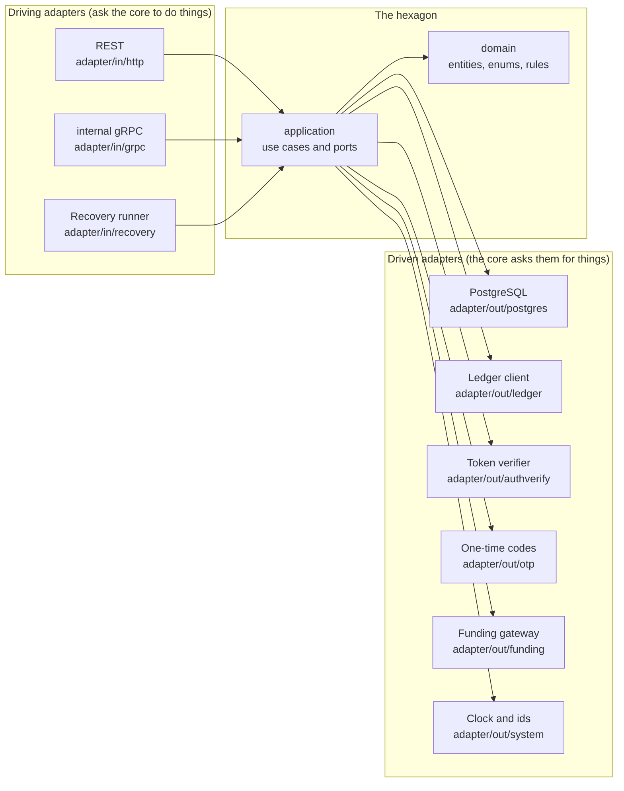
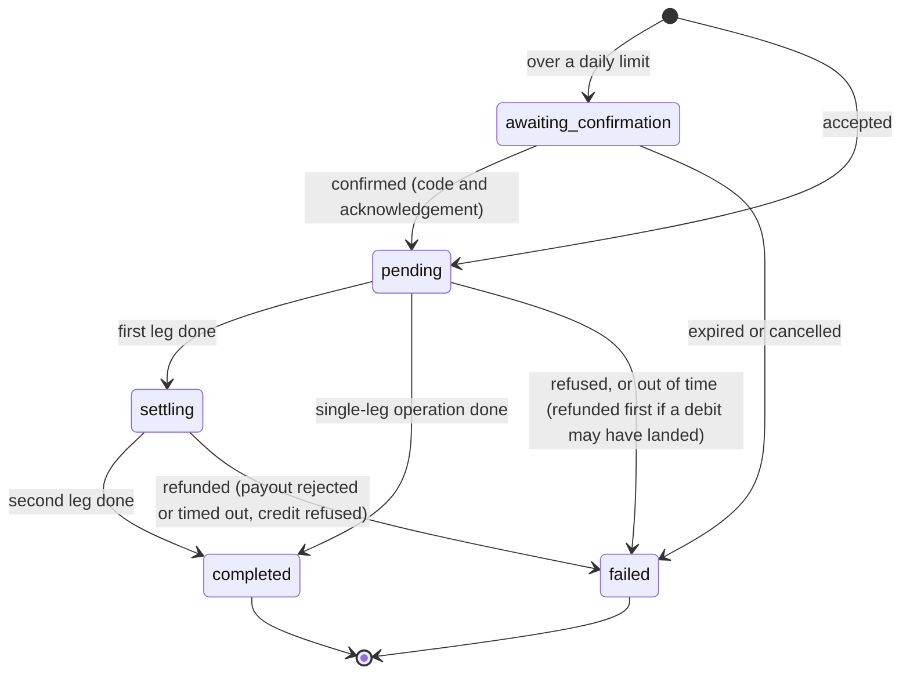

# Wallet service

The wallet service owns **who has which accounts, and whether they may move money**. A user has one
wallet; a wallet has several accounts; each account's money lives in the [ledger](ledger-service.md)
under the account's id. The wallet decides whether a movement is allowed (ownership, account status,
daily limits, one-time codes, reserved funds), records every movement as an *operation*, and sees
each one through to the ledger, however many times a dependency fails on the way.

- **Path:** [`services/wallet/`](../services/wallet), module `github.com/JackMahfouz/e-wallet/services/wallet`
- **Stack:** Go, hexagonal architecture, PostgreSQL 13 or newer (tested on 16), gRPC to the ledger and the auth service
- **Default addresses:** `127.0.0.1:8081` (REST, behind the [gateway](api-gateway.md)) and `127.0.0.1:9092` (gRPC, internal only)
- **Contract for other services:** [`proto/wallet/v1/wallet.proto`](../services/wallet/proto/wallet/v1/wallet.proto) (package `wallet.v1`, service `Wallet`)
- **Depends on:** the [ledger](ledger-service.md) (all money), the [auth service](libs-auth.md) (to check every bearer token), PostgreSQL (wallets, accounts, the operation journal, holds), and the shared [money package](process-money.md)

```text
user 1 ---- 1 wallet 1 ---- N accounts          wallet: the global daily limit
                                  |             account: its own limit, status, name
                                  +-- its own ledger (account id = ledger account id)
```

- [Concepts](#concepts)
- [Architecture](#architecture)
- [Authentication and one-time codes](#authentication-and-one-time-codes)
- [The REST API](#the-rest-api)
- [The rules](#the-rules)
- [How money reaches the ledger, and what happens when something fails](#how-money-reaches-the-ledger-and-what-happens-when-something-fails)
- [The internal gRPC API](#the-internal-grpc-api)
- [Funding: deposits and withdrawals](#funding-deposits-and-withdrawals)
- [Data model](#data-model)
- [Configuration](#configuration)
- [Run it](#run-it)
- [Tests](#tests)
- [Security notes](#security-notes)
- [Limitations and not built](#limitations-and-not-built)
- [Differences from the system design](#differences-from-the-system-design)
- [Troubleshooting](#troubleshooting)

## Concepts

| Term | Meaning |
| --- | --- |
| **Wallet** | One per user, made the first time the user calls the API. Holds the wallet-wide daily limit. |
| **Account** | A named balance in a wallet. `active`, `frozen` or `closed` (closed is final). Its id is also its ledger account id. |
| **Operation** | One entry in the journal: a credit, debit, transfer, deposit or withdrawal, and how far it has got. Its id is the ledger transaction id of every ledger call it makes. |
| **Hold** | Money reserved on an account for a payment that is not final. It cannot be spent by anyone else until it is captured, released or expires. |
| **Spending** | Money leaving the wallet: withdrawals, debits, and transfers to *another* wallet. Moving money between a user's own accounts is not spending. Spending is what daily limits count. |
| **Available** | What an account can spend now: the ledger balance, less active holds, less outgoing operations whose debit has not reached the ledger yet. |

Every id is a UUID, the user's included (the user id is the token's `sub`). Amounts are decimals at the
edge (`12.34`) and whole cents everywhere inside; see [Money](#money).

## Architecture

The wallet is a **hexagon** (ports and adapters). The rules live in a core that imports no database,
HTTP or gRPC code. Everything outside reaches it through interfaces the core defines, called *ports*,
and plugs in through *adapters*.



```text
services/wallet/
  cmd/server/main.go        the composition root: builds every adapter, plugs it into its port, starts everything
  proto/wallet/v1/          the internal gRPC contract;  gen/wallet/v1/ is the generated Go code (committed)
  migrations/               goose SQL, embedded in the binary
  internal/
    domain/                 entities, enums with explicit codes, rules, the working-day calendar. No I/O.
    application/            the use cases, and the ports they talk through (ports_in.go, ports_out.go)
    adapter/in/http/        REST       adapter/in/grpc/   internal gRPC       adapter/in/recovery/   timer
    adapter/out/postgres/   the store  adapter/out/ledger/ the ledger client   adapter/out/authverify/ tokens
    adapter/out/otp/        one-time codes     adapter/out/funding/  deposits and withdrawals
    adapter/out/system/     the clock and id generator
    config/                 environment variables
    testsupport/            in-memory fakes, the PostgreSQL test helper, the shared contract suites
```

**The dependency rule is a test.** [`internal/architecture_test.go`](../services/wallet/internal/architecture_test.go)
reads every package's imports and fails the build if one points outward: `domain` may import only the
standard library; `application` only `domain`, the money package and the standard library, and not `net`,
`net/http`, `database/sql` or `os`; an adapter may import the core but never another adapter; nothing but
`cmd` reads configuration. A second test fails if the core calls `time.Now` (it asks the `Clock` port, so
tests control time exactly). The rule engine is itself tested against deliberate violations, so the test
cannot pass by accident.

### The ports

| Port | Implemented by | Notes |
| --- | --- | --- |
| `Store` (a `Repository` plus `Do` for a transaction) | PostgreSQL adapter; an in-memory fake in tests | The same contract suite runs against both |
| `Ledger` | gRPC client; an in-memory fake that follows the ledger's rules | The same contract suite runs against both, and against the real ledger |
| `TokenVerifier` | Calls the auth service's `Verify` | |
| `OTPVerifier` | A static configured code, or "disabled" for development | The seam for real one-time codes later |
| `FundingGateway` | Simulated (succeeds at once), or a gateway that refuses everything | The seam for the Payment service later |
| `Clock`, `IDGenerator` | The system clock (UTC, whole microseconds), random UUIDs v4 | |

The inbound ports are `Wallets` (the user-facing use cases), `Internal` (the service-facing ones) and
`Recovery`. The REST adapter depends on the first, the gRPC adapter on the second, the timer on the third.

## Authentication and one-time codes

**Who is calling** is decided by the bearer token, checked with the auth service on every request. The
gateway also checks it and sets `X-User-ID`, but the wallet **ignores that header**: a token that does not
verify is a `401` whatever else the request says, and a token whose subject is not a UUID (the old
integer ids) is a `401` too. If the auth service is unreachable the answer is `503`, never "your token is
bad".

**One-time codes** confirm the actions that move or expose money. The code goes in the `X-OTP` header.

| Needs a code | Does not |
| --- | --- |
| Deposit, withdrawal, transfer | Reading anything |
| Confirming an over-limit operation | Creating an account |
| Closing an account | Renaming an account |
| Unfreezing an account | Freezing an account (the safe direction stays easy) |
| Setting or clearing any limit, wallet or account | Cancelling an operation that is awaiting confirmation |

Until `libs/auth` issues real one-time codes, the code is **one static value from configuration**
(`WALLET_OTP_STATIC_CODE`; the service refuses to start in `static` mode without it). **That is a shared
secret, not a second factor.** It proves nothing about the person: anyone who knows it is treated as the
user. It exists so the flow (a code on every sensitive action, a second one to confirm going over a limit)
is built and tested now, and real codes replace the adapter later without touching the core. The only
brake on guessing it is the gateway's per-route rate limit. `WALLET_OTP_MODE=disabled` accepts any code and
is for local development only; the service logs a warning at startup in both modes.

Ownership is checked before the code, and another user's account or operation is always `404`, never
`403`, so ids cannot be probed.

## The REST API

JSON over HTTP, reached through the gateway. Every route except `/health` needs
`Authorization: Bearer <access token>`.

| Method and path | What it does | Code |
| --- | --- | --- |
| `GET /v1/wallets/me` | The wallet: limit, spent today, and each account's balance, held, available, limit and spent today | |
| `PATCH /v1/wallets/me` | Set (`{"daily_limit": 200}`) or clear (`{"daily_limit": null}`) the wallet's daily limit | yes |
| `POST /v1/accounts` | Create an account: `{"name": "Savings", "daily_limit": 50}` (the limit is optional) | |
| `GET /v1/accounts/{id}` | One account | |
| `PATCH /v1/accounts/{id}` | Rename (`name`), set or clear the limit (`daily_limit`), freeze or unfreeze (`status`: `frozen` or `active`) | limit change, unfreeze |
| `DELETE /v1/accounts/{id}` | Close the account. Needs a zero balance, no active hold and nothing in flight | yes |
| `GET /v1/accounts/{id}/transactions` | Operations touching the account, newest first. `?limit=` (default 50, at most 200) and `?cursor=` | |
| `POST /v1/accounts/{id}/deposits` | `{"amount": 25.50}`. See [Funding](#funding-deposits-and-withdrawals) | yes |
| `POST /v1/accounts/{id}/withdrawals` | `{"amount": 10}` | yes |
| `POST /v1/transfers` | `{"from_account_id": "...", "to_account_id": "...", "amount": 3.5}`. The destination may be any user's account | yes |
| `GET /v1/operations/{id}` | An operation's state, for polling after a `202`. Visible to the owner of the account and, for a transfer, to the recipient | |
| `POST /v1/operations/{id}/confirm` | Confirm an over-limit operation: `{"acknowledge_over_limit": true}` | yes |
| `POST /v1/operations/{id}/cancel` | Abandon an over-limit operation that is waiting | |
| `GET /health` | Liveness; touches no dependency | |

**Headers.** `X-OTP` carries the one-time code. Every money `POST` (deposit, withdrawal, transfer) needs
`Idempotency-Key: <a UUID>`; see [Idempotency](#idempotency). Bodies are strict JSON: an unknown field, a
wrong type, trailing data or a body over 64 KiB is refused.

### Responses

An account, with amounts as decimals:

```json
{
  "id": "5c0f...", "wallet_id": "9a21...", "name": "Current", "status": "active",
  "daily_limit": 150, "balance": 749, "held": 0, "available": 749, "spent_today": 151,
  "created_at": "2026-11-11T12:00:00Z", "updated_at": "2026-11-11T12:03:10Z"
}
```

An operation:

```json
{
  "id": "e1d4...", "kind": "transfer", "status": "completed", "account_id": "5c0f...",
  "counterparty_account_id": "a77e...", "amount": 50, "spending": true,
  "created_at": "...", "updated_at": "...", "deadline_at": "2026-11-18T12:00:00Z", "completed_at": "..."
}
```

`kind` is `credit`, `debit`, `transfer`, `deposit` or `withdrawal`. `status` is `awaiting_confirmation`,
`pending`, `settling`, `completed` or `failed`; a failed one also has `failure_reason`
(`insufficient_funds`, `timed_out`, `confirmation_expired`, `rejected` or `cancelled`). While it awaits
confirmation it carries `confirmation: {"limit_scope": "account", "expires_at": "..."}`.

What a money `POST` answers depends on how far the operation got:

| Status | Meaning |
| --- | --- |
| `201` | Completed |
| `202` | Accepted but not finished (a dependency was unreachable). It finishes in the background; poll `GET /v1/operations/{id}` |
| `409` `confirmation_required` | Over a daily limit. Nothing has moved. The body holds the saved operation; see [Over a limit](#over-a-limit-a-strict-two-step-confirmation) |
| `422` `operation_failed` | It failed. The body holds the operation and its `failure_reason` |

### Errors

Every error is `{"message": "...", "code": "..."}`.

| Status | `code` | When |
| --- | --- | --- |
| `400` | `invalid_request`, `invalid_amount` | Bad input: a malformed id, a missing `Idempotency-Key`, an amount with more than two decimals, a zero or negative amount |
| `401` | `unauthenticated` | No token, a token that does not verify, or a subject that is not a UUID |
| `403` | `otp_invalid`, `funding_disabled` | The one-time code is missing or wrong; deposits and withdrawals are switched off |
| `404` | `not_found` | Unknown id, or someone else's |
| `409` | `confirmation_required`, `idempotency_key_reused`, `account_not_active`, `limit_exceeds_wallet_limit`, `conflict` | A state the request cannot be applied to: see the message |
| `413` | `body_too_large` | |
| `422` | `insufficient_funds`, `operation_failed` | Not enough available (`insufficient funds: 10.50 available, 20.00 requested`); an operation that ended failed |
| `503` | `unavailable` | The ledger or the auth service cannot be reached, *before* anything was recorded. Safe to retry. |
| `500` | `internal_error` | A bug; the detail is only in the log |

## The rules

### Money

Amounts arrive and leave as decimals, are checked and cast by the shared [money package](process-money.md)
(finite, greater than zero, at most `10000000000`, a whole number of cents, never silently rounded), and
are whole cents inside the wallet and in its database. Balances read from the ledger are cast back the same way.
There is no currency: like the ledger, the wallet assumes one two-decimal currency.

### Available, and what is spendable

`available = ledger balance - active holds - pending outgoing operations`. It is never negative. The
pending operations and holds are read first and the ledger balance last, so an operation moving between
"pending" and "debited" at that instant is counted twice (a refusal that retrying fixes) and never zero
times (an overspend).

### Limits

- **No system-wide ceiling.** A user defines a limit on the wallet, a limit on any account, both or neither.
  Limits are *soft*: going over one is not refused, it needs a confirmation (below).
- **The sum rule.** The limits that are set on a wallet's open accounts may not add up to more than the
  wallet's limit. An account with no limit of its own is bounded only by the wallet limit. A change that
  would break the rule is refused with `limit_exceeds_wallet_limit`, whichever limit is being changed.
  Closed accounts do not count.
- **What counts as spent today.** The sum of the account's (or the wallet's) *spending* operations that
  became pending since UTC midnight and are still pending, settling or completed. Failed operations and
  ones awaiting confirmation do not count. Transfers between the user's own accounts and credits and
  deposits never count.

### Over a limit: a strict two-step confirmation

A spend that would take the account or the wallet over its limit is **saved, not refused**, and nothing
moves:

1. The request is recorded as `awaiting_confirmation` and answered `409 confirmation_required`, with the
   operation, which limit it would break (`account` or `wallet`) and when the window closes
   (`WALLET_CONFIRM_TTL`, ten minutes). Nothing is reserved; the funds are checked again at step 2.
2. The user finishes it with `POST /v1/operations/{id}/confirm`, **a one-time code** and
   `{"acknowledge_over_limit": true}`. Without the acknowledgement it is a `400`; with a wrong code a
   `403`. Confirming twice is harmless.

If nobody confirms in time it becomes `failed(confirmation_expired)`; `cancel` makes it
`failed(cancelled)` and needs no code. Repeating the original request with the same idempotency key asks
for the same confirmation again. A spend asked for by another service over gRPC is treated the same way,
and the *account's owner* confirms it over REST.

### Accounts

- **Only an `active` account can send or receive**: a frozen or closed one refuses both directions, for
  users and for other services alike.
- **Closing** is final. It needs a zero ledger balance, no active hold and no operation in flight on
  either side, and is idempotent.
- **At most `WALLET_MAX_ACCOUNTS` open accounts** per wallet (default 10).

### Idempotency

Every money `POST` and every money call over gRPC carries a UUID idempotency key. Repeating a request with
the same key returns the operation the first one made (and drives it on if it had stalled); the same key
with a *different* request is `409 idempotency_key_reused`. Keys are scoped to who is asking (`user:<id>`
or `service:<name>`), so two callers may use the same value. Two requests racing with the same key make
one operation: the database's unique index lets one win, and the other finds its row.

### Holds

Another service reserves money with `CreateHold` (an amount, a reason, a lifetime up to
`WALLET_MAX_HOLD_TTL`). While active, the amount is subtracted from `available`. A debit or transfer that
names the hold **captures** it: it is consumed in the same transaction that records the operation, so it
cannot expire half-way, and the amount may be up to the hold's. If that operation then fails, the capture
is undone. Users see what is held but cannot make or release holds. Only the service that made a hold can
release it; a captured hold cannot be released; closing an account needs it to have none.

## How money reaches the ledger, and what happens when something fails

The wallet and the ledger are separate services with separate databases, so no single transaction can
cover both. The wallet keeps them consistent with a **journal and idempotent calls**:

1. The operation is written to the journal and committed *first*. From then on it exists, whatever
   happens to the request.
2. Each ledger call carries the **operation's id as its transaction id**. The ledger applies each
   (account, transaction id, direction) once, so any call can be repeated safely.
3. Each step records its result with a compare-and-set on the operation's row. If something else (the
   recovery job, a retried request) moved the operation first, the slow one carries on from where it
   really is.

An operation moves in up to two *legs*; its status records which are done.



| Kind | First leg (`pending` to `settling`) | Second leg (`settling` to `completed`) |
| --- | --- | --- |
| transfer | ledger debit of the source | ledger credit of the destination |
| withdrawal | ledger debit of the account | funding payout |
| deposit | funding collect | ledger credit of the account |
| debit (a service) | ledger debit (completes directly) | |
| credit (a service) | ledger credit (completes directly) | |

A **refund** is a ledger credit to the source with the *same transaction id as the debit*. It is a
different direction from the debit, so the ledger applies it once like any other call; the operation then
records `refunded_at` and fails.

### When a dependency is down

| Where it stopped | What the caller sees | What happens next |
| --- | --- | --- |
| The ledger is unreachable *before* the operation is recorded (the funds check needs it) | `503`, nothing recorded | The caller retries |
| The ledger is unreachable when the debit is attempted | `202` (or a `PENDING` operation over gRPC) | Recovery retries until the ledger answers |
| The ledger applied a call but the answer was lost, or the status could not be saved | the same | The repeated call is recognised by the ledger as a replay, and the status is recorded then |
| The credit leg of a transfer cannot reach the ledger | `202`; the money has left the source and not arrived | Recovery retries; it is never refunded on a guess |
| The auth service is down | `503` on every route | |

### The five-working-day rule

An operation gets **five working days** (Monday to Friday, UTC, the same time of day; public holidays are
not modelled) from the moment it is accepted. Each operation records its `deadline_at`. An operation that
has not succeeded by then is failed, **where that can be done without losing money**:

| State at the deadline | What happens |
| --- | --- |
| `pending` money-out operation (transfer, withdrawal, debit), ledger reachable | The debit is repeated; whether or not it had landed, it is **refunded** and the operation fails as `timed_out`. The ledger shows the debit and its refund. |
| `pending` deposit whose collection never succeeded | Fails as `timed_out`. Nothing was collected, so nothing was credited. |
| `settling` withdrawal whose payout still cannot be made | The debit is **refunded** and the operation fails as `timed_out` |
| `awaiting_confirmation` | Not this rule: it has its own ten-minute window |
| `settling` transfer, `settling` deposit | **Not failed.** The money has left its source (or been collected), so failing would need a refund the wallet cannot prove is safe; it is retried until the ledger answers. |
| Any money-out operation while the ledger is **down** | **Not failed.** Whether a debit reached the ledger cannot be known without asking it, so the operation is kept rather than failed on a guess, and failed (and refunded) when the ledger answers. |

So the rule is exact whenever the ledger can be asked, and never costs a user money when it cannot.
`WALLET_OPERATION_TIMEOUT_WORKDAYS=0` makes every operation immediately out of time, which is how the
refund path is tested end to end.

### The recovery job

A timer ([`adapter/in/recovery`](../services/wallet/internal/adapter/in/recovery)) calls the core every
`WALLET_RECOVERY_INTERVAL` (15 seconds). Each pass fails confirmations whose window closed, then claims
operations whose next attempt is due and drives them on. A new operation is left to its own request for
`WALLET_RECOVERY_MIN_AGE` (30 seconds) first. Claiming is one SQL statement using `FOR UPDATE SKIP LOCKED`
that also pushes the operation's next attempt on, so **several wallet instances never pick up the same
operation**, and the delay between attempts grows with each one (up to twenty times the base).

### Locks

Every use case locks in one order, so none can deadlock: the **wallet** row, then the **account** rows
in ascending id order, then holds, then the operation. The wallet lock is what keeps the wallet-wide
limit honest when two accounts spend at once. The account lock is what keeps `available` honest: the
debit leg holds it across the ledger call, because between the ledger applying a debit and the operation
saying so, the money would otherwise be counted twice.

## The internal gRPC API

For other services (the Payment service, later). **Internal only: never route it through the gateway.**
Like the ledger and the auth service, it carries no per-call credentials; restrict who can reach it with
the network or a mesh policy.

```proto
service Wallet {
  rpc Credit(MoveRequest)   returns (Operation);   // add money to an account
  rpc Debit(MoveRequest)    returns (Operation);   // take money from an account (optionally capturing a hold)
  rpc Transfer(MoveRequest) returns (Operation);   // move money between two accounts (optionally capturing a hold)
  rpc GetOperation(GetOperationRequest) returns (Operation);
  rpc CreateHold(CreateHoldRequest)     returns (Hold);
  rpc ReleaseHold(ReleaseHoldRequest)   returns (Hold);
  rpc GetAccount(GetAccountRequest)     returns (Account);
}
```

Money calls carry `service` (who is asking, lower case: `payment`) and an `idempotency_key`. They return
the operation however far it got: a `PENDING` or `SETTLING` operation is not an error; it finishes in the
background and `GetOperation` shows how it ended. A spend over a limit comes back as an operation with
status `AWAITING_CONFIRMATION` and a `confirmation`, not as an error, and the account's owner confirms it
over REST. Enums and the timestamps (microseconds since the Unix epoch) follow the ledger's conventions.

| gRPC code | When |
| --- | --- |
| `INVALID_ARGUMENT` | A bad id, amount, service name, key or TTL |
| `NOT_FOUND` | Unknown account, operation or hold (or someone else's hold) |
| `ALREADY_EXISTS` | An idempotency key reused for a different request |
| `FAILED_PRECONDITION` | `insufficient funds: 10.00 available, 11.00 requested`; an account that is not active; a hold that is spent or expired; releasing a captured hold |
| `UNAVAILABLE` | The ledger could not be reached before anything was recorded |
| `INTERNAL` | A bug; the message is just `internal error` |

## Funding: deposits and withdrawals

A deposit collects money from outside and credits the account; a withdrawal debits the account and pays
out. The outside world is a port, `FundingGateway`, whose calls are idempotent in the operation's id. The
only adapter today is **simulated**: it succeeds at once and moves nothing real, so a "deposit" creates
ledger money with nothing behind it.

Because of that it is **off unless enabled**. `WALLET_FUNDING_MODE` defaults to `disabled`: the endpoints
still authenticate the user and check the one-time code, then answer `403 funding_disabled`, and the adapter plugged into the port refuses everything as a second lock. Set `simulated` for development and demos
(the `make run-dev` target does). A real gateway (the Payment service's card and bank rails) replaces the
adapter later. Service-initiated `Credit` and `Debit` over gRPC do not use the gateway: the Payment
service does its own card work.

## Data model

Migrations are goose SQL files in [`migrations/`](../services/wallet/migrations), embedded in the binary
and applied at startup (`WALLET_MIGRATE`) under an advisory lock, so several instances starting at once
is safe. Every id is a `uuid`, every amount is whole cents in a `bigint`, every time is a `timestamptz`
from the application's clock, and every enum is a **`smallint` with an explicit code and a `CHECK`**
(PostgreSQL has no `tinyint`). The Go enums carry the same codes, and a test reads the `CHECK`
constraints from the database to prove the two agree.

| Table | What it holds |
| --- | --- |
| `wallets` | `id`, `user_id` (unique), `daily_limit` (null means none) |
| `accounts` | `id`, `wallet_id`, `name`, `status`, `daily_limit`, `closed_at` |
| `operations` | The journal: `kind`, `account_id`, `counterparty_id`, `amount`, `hold_id`, `status`, `failure_reason`, `limit_scope`, `initiator`, `idempotency_key` (unique with `initiator`), `request_hash`, `spending`, `deadline_at`, `attempts`, `next_attempt_at`, and the times it was executed, refunded and completed |
| `holds` | `account_id`, `amount`, `reason`, `expires_at`, `released_at`, `captured_by`, and its own idempotency key |

| Enum | Codes |
| --- | --- |
| Account status | 1 active, 2 frozen, 3 closed |
| Operation kind | 1 credit, 2 debit, 3 transfer, 4 deposit, 5 withdrawal |
| Operation status | 1 awaiting confirmation, 2 pending, 3 settling, 4 completed, 5 failed |
| Failure reason | 1 insufficient funds, 2 timed out, 3 confirmation expired, 4 rejected, 5 cancelled |
| Limit scope | 1 account, 2 wallet |

The database also refuses rows the code would never write: a transfer without a destination, a failed
operation without a reason, a pending one that was never executed, a closed account with no closing time,
a hold that is both released and captured, and more. There is no stored balance anywhere: the ledger is
the only record of how much an account holds.

## Configuration

Environment variables. The service refuses to start on an invalid value and names it.

| Variable | Default | Meaning |
| --- | --- | --- |
| `WALLET_HTTP_ADDR` | `127.0.0.1:8081` | REST listen address (the gateway routes here) |
| `WALLET_GRPC_ADDR` | `127.0.0.1:9092` | Internal gRPC listen address. Never route it through the gateway. |
| `WALLET_DATABASE_URL` | required | PostgreSQL connection string |
| `WALLET_DATABASE_PASSWORD_FILE` | none | A file holding the password, so it need not be in the environment |
| `WALLET_MIGRATE` | `true` | Apply migrations at startup |
| `WALLET_LEDGER_ADDR` / `WALLET_LEDGER_TIMEOUT` | `127.0.0.1:9091` / `3s` | The ledger's gRPC address, and each call's timeout |
| `WALLET_AUTH_ADDR` / `WALLET_AUTH_TIMEOUT` | `127.0.0.1:9090` / `2s` | The auth service's gRPC address, and each call's timeout |
| `WALLET_OTP_MODE` | `static` | `static` (one configured code) or `disabled` (accept anything; development only) |
| `WALLET_OTP_STATIC_CODE` | none | The code. **Required** in `static` mode: there is no default, so the service will not start without one |
| `WALLET_FUNDING_MODE` | `disabled` | `disabled` (deposits and withdrawals refused) or `simulated` (they succeed with nothing behind them) |
| `WALLET_MAX_ACCOUNTS` | `10` | Open accounts per wallet |
| `WALLET_MAX_HOLD_TTL` | `168h` | The longest a hold may last |
| `WALLET_CONFIRM_TTL` | `10m` | How long an over-limit operation waits for its confirmation |
| `WALLET_OPERATION_TIMEOUT_WORKDAYS` | `5` | Working days before an unfinished operation is failed (`0` means at once, for tests) |
| `WALLET_RECOVERY_INTERVAL` | `15s` | How often recovery runs (`0` turns it off, with a warning) |
| `WALLET_RECOVERY_MIN_AGE` | `30s` | How long a new operation is left to its own request before recovery may pick it up |

## Run it

Needs a PostgreSQL, the [ledger](ledger-service.md) and the [auth service](libs-auth.md) running, as in
[docs/README.md](README.md#run-everything-locally).

```bash
cd services/wallet
make test-db-up                 # a throwaway PostgreSQL on 127.0.0.1:55433 (skip if you have one)
make run-dev                    # static one-time code 123456, simulated funding. Never anywhere real.
```

Then, through the gateway, with an access token from Identity (or issued from the auth service for a
user id that is a UUID):

```bash
GW=http://127.0.0.1:8080
H=(-H "Authorization: Bearer $ACCESS_TOKEN" -H 'Content-Type: application/json')

# An account, then 100.00 into it (needs the code and an idempotency key)
ACCOUNT=$(curl -s -X POST $GW/v1/accounts "${H[@]}" -d '{"name":"Current"}' | jq -r .id)
curl -s -X POST $GW/v1/accounts/$ACCOUNT/deposits "${H[@]}" \
  -H 'X-OTP: 123456' -H "Idempotency-Key: $(uuidgen)" -d '{"amount":100}'

# Set a daily limit, then spend more than it: the second call needs confirming
curl -s -X PATCH $GW/v1/accounts/$ACCOUNT "${H[@]}" -H 'X-OTP: 123456' -d '{"daily_limit":50}'
curl -s -X POST $GW/v1/accounts/$ACCOUNT/withdrawals "${H[@]}" \
  -H 'X-OTP: 123456' -H "Idempotency-Key: $(uuidgen)" -d '{"amount":80}'      # 409 confirmation_required
curl -s -X POST $GW/v1/operations/$OPERATION/confirm "${H[@]}" \
  -H 'X-OTP: 123456' -d '{"acknowledge_over_limit": true}'                    # 201 completed
```

## Tests

```bash
cd services/wallet
make test-db-up && make test       # vet, then the whole suite with the race detector; make test-db-down afterwards
```

`make test` requires the database (a missing one fails the run instead of skipping). The suite is layered
so each kind of fault is caught where it is cheapest to see:

- **Domain**, pure and fast: the enum codes, the working-day calendar (weekends, month and year ends), the limit arithmetic, the state transitions.
- **Application, against in-memory fakes**: every use case, with the ledger, funding and the database failing at each step and then recovering: lost responses, a status that cannot be saved, the deadline, refunds, a stale executor racing recovery, and a **randomized fault test** that fires random failures at 40 seeds of concurrent transfers and checks that money is never created or lost and every operation ends in a final state.
- **Contract suites**, one per port, run against the fake *and* the real adapter so the fake cannot drift: the store (fake and PostgreSQL), and the ledger port (fake, the gRPC client over a fake server, and the real ledger when `WALLET_TEST_LEDGER_ADDR=127.0.0.1:9091` is set).
- **Adapters**: PostgreSQL (constraints, the enum codes against the `CHECK`s, row locks, `SKIP LOCKED`, unique keys), REST and gRPC over real connections (every route, header and error code), the ledger and auth clients against slow, failing and dead servers.
- **Concurrency on real PostgreSQL**: many parallel withdrawals never overspend; thirty accounts of one wallet spending at once never exceed the wallet limit; a debit held in flight makes the next request wait rather than miscount; several recovery workers never advance one operation twice; flaky-ledger transfers conserve money and all finish.
- **Architecture**: the dependency rule, as a test.

## Security notes

- **The caller is the token.** Checked with the auth service on every request; `X-User-ID` is ignored.
- **Another user's data is `404`**, never `403`.
- **Ledger and gRPC are internal.** Neither carries an application-level secret. Keep both ports off the gateway and restrict callers with the mesh or network policy. Any service that can reach the wallet's gRPC port can credit, debit and hold on any account.
- **The one-time code is a static secret** until `libs/auth` issues real ones. See [above](#authentication-and-one-time-codes).
- **Simulated funding creates money.** It is off unless `WALLET_FUNDING_MODE=simulated`, and logs a warning when on.
- **Logs** carry method, path, status and timing, never headers, bodies, tokens or one-time codes.
- **Secrets by file:** the database password can be a file path (`WALLET_DATABASE_PASSWORD_FILE`).

## Limitations and not built

- **No events.** The design's `wallet.events` Kafka topic is not produced; `internal/events/` is an empty placeholder.
- **No velocity limits, fees, KYC tiers or system-wide ceilings.** Limits are the user's own, and soft.
- **No currency.** One implied two-decimal currency, as in the ledger.
- **Public holidays** are not part of the working-day rule.
- **The five-day rule has the exceptions listed above**, by design: it never fails an operation it cannot prove safe to fail.
- **Reading a wallet makes one ledger call per account**, and reads fail with `503` while the ledger is down.
- **Users cannot place or release holds**, only see them.
- **A static one-time code**, with only the gateway's rate limit against guessing it.
- **No Dockerfile or Helm chart**, and no metrics.
- **A closed account cannot be reopened.**

## Differences from the system design

- **Accounts.** The design has one wallet per user with a `balance`, a `hold_balance` and a `currency`. Here a wallet has several accounts, there is **no stored balance** (the ledger is the only record), and there is no currency column.
- **Holds** exist, but belong to an account and are created over gRPC, not by users.
- **Layout.** The design's reference Go layout (`service`, `handler`, `store`) is replaced for this service by the hexagonal one above.
- **Limits.** The design has one `daily_limit` per wallet; here a wallet limit and per-account limits with a sum rule, going over either needs a strict two-step confirmation, and there is no velocity limit yet.
- **Transfers.** The design runs a P2P transfer as a Payment-led saga. Here the wallet also exposes user-facing transfers, deposits and withdrawals itself, with its own journal and recovery; the Payment service (not built) will use the gRPC API.
- **One-time codes and idempotency keys** are on every sensitive action, which the design does not describe.
- **No `wallet.events`** (see above).
- **Ids** are UUIDs throughout, and Identity's user ids were switched to UUIDs to match.

## Troubleshooting

| Symptom | Cause and fix |
| --- | --- |
| Exits at start with `WALLET_OTP_STATIC_CODE is required` | Set the code, or `WALLET_OTP_MODE=disabled` for local development |
| `403 funding_disabled` on a deposit | Funding is off; set `WALLET_FUNDING_MODE=simulated` for development |
| `401` with a token that works elsewhere | The token's subject is not a UUID (a token issued for an old integer user id), or the auth service rejected it |
| `503 unavailable` everywhere | The auth service or the ledger is down or `WALLET_AUTH_ADDR` / `WALLET_LEDGER_ADDR` is wrong; the log says which call failed |
| `202` and the operation stays `pending` | The ledger is unreachable; recovery retries. If recovery is off (`WALLET_RECOVERY_INTERVAL=0`) nothing will |
| `409 limit_exceeds_wallet_limit` | The accounts' limits would add up to more than the wallet's: lower one, or raise the wallet limit first |
| `403 otp_invalid` | The `X-OTP` header is missing or is not the configured code |
| `400` "an Idempotency-Key (a UUID) is required" | Money `POST`s need an `Idempotency-Key` header holding a UUID |
| Database tests are skipped | Set `WALLET_TEST_DATABASE_URL`, or use `make test` |
